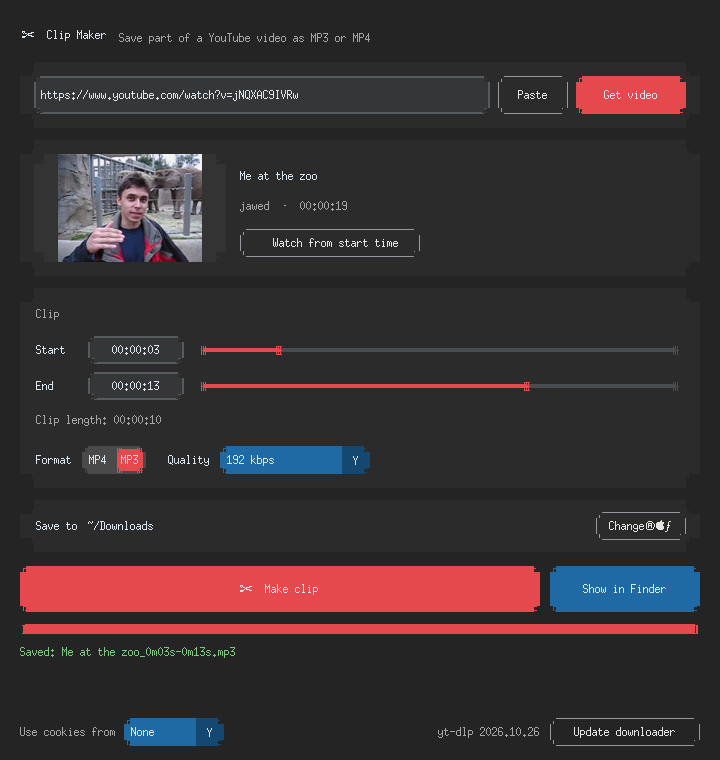

# ✂ Clip Maker

A small Mac app that saves **just part** of a YouTube video as an **MP3** (audio) or **MP4** (video).
Paste a link → pick start and end → choose MP3 or MP4 → **Make clip**. Done.


<sub>(Screenshot taken on Linux, where fonts and corners look rougher. On a Mac it uses the system font and follows Light/Dark mode.)</sub>

---

## Setup (once)

1. **Unzip** `clip-maker.zip` somewhere you'll keep it, e.g. your Documents folder.
2. **Double-click `Clip Maker.command`.**
   - If macOS says it *"cannot be opened because it is from an unidentified developer"*,
     **right-click → Open → Open**. (You only need to do this once.)
   - Or, in Terminal:
     `xattr -dr com.apple.quarantine ~/Documents/clip-maker`
3. The first run takes **1–5 minutes**. It:
   - checks for **Homebrew** (if it's missing, it tells you how to install it and stops),
   - installs **ffmpeg** (cuts and converts video) and **Deno** (YouTube now needs a JavaScript runtime for downloads),
   - finds or installs a Python with working Tk (`python-tk`),
   - builds a private Python environment in `clip-maker/.venv` and installs the packages.
4. After that, it opens straight away.

**Optional: a real app icon.** In Terminal, run this once:

```bash
cd ~/Documents/clip-maker && ./make_app.sh
```

This creates **`~/Applications/Clip Maker.app`**, which you can find in Spotlight (⌘Space → "Clip Maker") or drag to the Dock.
It starts the app without a Terminal window. If you move the `clip-maker` folder later, run `make_app.sh` again.

## Using it

1. Copy a video link from YouTube, then click **Paste** (or press ⌘V in the box and hit Return / **Get video**).
2. Set **Start** and **End**. Drag the sliders or type times like `1:23`, `01:02:03`, or `45`.
   - **▶ Watch from start time** opens the video in your browser at that spot, so you can check it.
3. Choose **MP4** (Best / 1080p / 720p / 480p) or **MP3** (128 / 192 / 320 kbps).
4. **Save to**: `~/Downloads` by default. Click **Change…** to pick another folder; it's remembered.
5. Click **✂ Make clip** (or press ⌘Return). Watch the progress bar, or click **Cancel** to stop.
6. When it's done, click **Show in Finder**.

Files are named like `Video Title_1m05s-1m30s.mp4`. If the name is taken, it adds `(2)`.

## Good to know

- **Only your section is downloaded**, not the whole video, so long videos are quick.
  Cuts are frame-accurate: the edges are re-encoded at the cut points.
  If YouTube refuses a section download, the app downloads the full video and cuts it on your Mac.
  That's slower, but the app does it for you.
- **MP4s are H.264 + AAC**, so they play in QuickTime, Photos, iMovie, and on iPhone.
  "Best" means the best *QuickTime-friendly* quality, which on YouTube is usually up to 1080p.
  If a video has no H.264 version, the app converts it automatically, which takes a bit longer.
- **Update downloader** (bottom right): YouTube changes often. If downloads start failing,
  click this first, then restart the app. It updates `yt-dlp` and shows the version.
- **Use cookies from** (bottom left): leave this on **None**. For age-restricted videos,
  or if YouTube says *"confirm you're not a bot"*, pick the browser where you're signed in to YouTube.
  macOS may ask for permission; Safari may need Full Disk Access for Terminal or Python.
  Opera GX counts as "Opera".
- **Errors are in plain English**, for example a private video, an age-restricted video,
  a bad link, no internet, or ffmpeg missing.
- **Settings** are saved in `~/Library/Application Support/ClipMaker/config.json`.

## Troubleshooting

| Problem | Fix |
|---|---|
| "ffmpeg is missing" | `brew install ffmpeg` |
| Window doesn't open / Tk error | `brew install python-tk@3.12` (match your Python version), then `./"Clip Maker.command" --reinstall` |
| Something's broken after an update | `./"Clip Maker.command" --reinstall` rebuilds the Python environment |
| Downloads fail with 403 / "not a bot" | Click **Update downloader**, restart; then try **Use cookies from** |
| Apple says the app is damaged / can't be opened | `xattr -dr com.apple.quarantine ~/Applications/"Clip Maker.app"` (and the folder) |

## Why Python + CustomTkinter?

- **CustomTkinter** gives a modern look (rounded cards, Light/Dark following macOS) using plain Tk,
  which ships with Python. It adds only one small pip package, and there's no web engine to bundle or debug.
- The known Homebrew catch is that Homebrew's Python ships **without** Tk.
  The launcher checks for this and installs the matching `python-tk@3.x` (or uses python.org Python if you have it).
- We passed on pywebview: it would look more native-web, but it adds another moving part
  (a WebKit bridge, JS↔Python calls) for no real gain in a one-window tool.

## Files

```
Clip Maker.command   ← double-click to run (does first-time setup)
make_app.sh          ← optional: builds ~/Applications/Clip Maker.app
app.py               ← the window (CustomTkinter)
core.py              ← download / cut logic (yt-dlp + ffmpeg), no GUI
requirements.txt
assets/icon.icns     ← app icon
tests/test_core.py   ← headless tests:  .venv/bin/python tests/test_core.py [--online]
```

## Please note

This is a **personal tool**. YouTube's Terms of Service don't allow downloading videos without permission,
and most videos are copyrighted. Use it for your own videos, videos you have permission to use,
or personal use such as study notes, and don't re-upload or share other people's content.
